# Test results: 9 models on 100 new games per speed

Models trained on all 2,000 EDA games per speed; tested on 100 games per speed pulled later the same day (zero overlap). Brackets = 95% interval from resampling test games.

| speed | training (games / moves) | test (games / moves) |
|---|---:|---:|
| bullet | 2,000 / 121,517 | 100 / 6,068 |
| blitz | 2,000 / 133,646 | 100 / 6,788 |
| classical | 2,000 / 132,825 | 100 / 6,800 |

## Blunder models (A: blunder now, B: blunder in next 5)

| speed | target | AUC | PR-AUC (base rate) | top-10% flagged: hit rate / blunders caught | Brier skill | predicted vs actual count | CV AUC (training) |
|---|---|---|---|---|---|---|---|
| bullet | blunder | 0.867 (0.848–0.884) | 0.302 (0.055) | 28% / 51% | 0.153 (0.112–0.190) | 307 vs 329 | 0.852 |
| bullet | blunder in next 5 | 0.793 (0.760–0.823) | 0.490 (0.205) | 57% / 28% | 0.187 (0.143–0.230) | 1182 vs 1242 | 0.769 |
| blitz | blunder | 0.846 (0.824–0.865) | 0.243 (0.049) | 23% / 46% | 0.114 (0.074–0.154) | 332 vs 329 | 0.849 |
| blitz | blunder in next 5 | 0.784 (0.755–0.811) | 0.467 (0.198) | 56% / 28% | 0.172 (0.132–0.213) | 1313 vs 1345 | 0.774 |
| classical | blunder | 0.870 (0.848–0.890) | 0.197 (0.037) | 19% / 50% | 0.093 (0.060–0.127) | 280 vs 250 | 0.858 |
| classical | blunder in next 5 | 0.779 (0.747–0.808) | 0.382 (0.156) | 47% / 30% | 0.138 (0.094–0.177) | 1165 vs 1061 | 0.781 |

- **AUC**: pick a random move that was a blunder and one that wasn't; AUC = how often the model gave the blunder the higher risk (0.5 = coin flip, 1 = perfect).
- **PR-AUC**: how precise the alarms are across all thresholds; compare with the base rate (what a random guess gets).
- **Top-10% flagged**: flag the 10% riskiest moves; hit rate = share of flags that were blunders, caught = share of all blunders that were flagged.
- **Brier skill**: how much smaller the average squared gap between predicted chance and outcome (0/1) is than always guessing the training base rate (0 = no better, 1 = perfect).
- **Accuracy at a 50% threshold** is not shown in the table because it is misleading for rare events: 'never a blunder' already scores 95%. It is in the per-speed sections.

## 1/0 flags: flag = 1 if predicted chance ≥ cutoff

Each cutoff was chosen on the training games (cross-validation predictions) by the rule **best F1** (balance of 'flags that are real' and 'events caught'), then applied unchanged to the test games. Codes: first digit = flag, second = actual.

| speed | target | cutoff | moves flagged | 00 quiet | 11 caught | 10 false alarm | 01 missed | flags that were real (precision) | 1s caught (recall) | F1 | accuracy (always 0) |
|---|---|---|---|---|---|---|---|---|---|---|---|
| bullet | blunder | 17.9% | 7.6% | 5,305 | 143 | 306 | 186 | 32% (27%–36%) | 43% (37%–49%) | 0.37 | 91.7% (94.5%) |
| bullet | blunder in next 5 | 22.6% | 36.2% | 3,515 | 884 | 1311 | 358 | 40% (35%–46%) | 71% (65%–77%) | 0.51 | 72.5% (79.5%) |
| blitz | blunder | 14.6% | 8.5% | 5,910 | 136 | 428 | 193 | 24% (20%–28%) | 41% (33%–48%) | 0.30 | 90.7% (95.1%) |
| blitz | blunder in next 5 | 23.4% | 34.4% | 4,016 | 907 | 1427 | 438 | 39% (34%–44%) | 67% (61%–74%) | 0.49 | 72.5% (80.2%) |
| classical | blunder | 16.2% | 5.5% | 6,140 | 89 | 279 | 161 | 24% (19%–29%) | 36% (27%–43%) | 0.29 | 93.4% (96.3%) |
| classical | blunder in next 5 | 22.3% | 31.0% | 4,296 | 668 | 1443 | 393 | 32% (27%–37%) | 63% (57%–69%) | 0.42 | 73.0% (84.4%) |

**Same models, other ways to pick the cutoff** (each chosen on the training games, scored on the test games):

| speed | target | rule | cutoff | moves flagged | accuracy | 0s right | 1s right | flags that were real |
|---|---|---|---|---|---|---|---|---|
| bullet | blunder | accuracy | 78.2% | 0.0% | 94.5% | 100.0% | 0.0% | – |
| bullet | blunder | f1 (used) | 17.9% | 7.6% | 91.7% | 94.5% | 43.5% | 32% |
| bullet | blunder | balanced | 5.2% | 26.9% | 76.8% | 76.4% | 82.7% | 17% |
| bullet | blunder in next 5 | accuracy | 51.4% | 5.3% | 80.7% | 97.5% | 15.8% | 61% |
| bullet | blunder in next 5 | f1 (used) | 22.6% | 36.2% | 72.5% | 72.8% | 71.2% | 40% |
| bullet | blunder in next 5 | balanced | 19.2% | 43.1% | 68.2% | 65.8% | 77.6% | 37% |
| blitz | blunder | accuracy | 52.2% | 0.1% | 95.0% | 99.9% | 0.6% | 25% |
| blitz | blunder | f1 (used) | 14.6% | 8.5% | 90.7% | 93.2% | 41.3% | 24% |
| blitz | blunder | balanced | 4.1% | 34.5% | 69.0% | 68.2% | 85.1% | 12% |
| blitz | blunder in next 5 | accuracy | 48.2% | 6.5% | 81.6% | 96.9% | 20.0% | 61% |
| blitz | blunder in next 5 | f1 (used) | 23.4% | 34.4% | 72.5% | 73.8% | 67.4% | 39% |
| blitz | blunder in next 5 | balanced | 16.5% | 47.8% | 63.8% | 60.0% | 79.3% | 33% |
| classical | blunder | accuracy | 57.6% | 0.0% | 96.3% | 100.0% | 0.0% | – |
| classical | blunder | f1 (used) | 16.2% | 5.5% | 93.4% | 95.7% | 35.6% | 24% |
| classical | blunder | balanced | 3.9% | 30.5% | 72.3% | 71.7% | 87.6% | 11% |
| classical | blunder in next 5 | accuracy | 50.3% | 3.4% | 84.5% | 98.1% | 11.1% | 52% |
| classical | blunder in next 5 | f1 (used) | 22.3% | 31.0% | 73.0% | 74.9% | 63.0% | 32% |
| classical | blunder in next 5 | balanced | 17.2% | 41.0% | 66.6% | 65.2% | 74.4% | 28% |

- **accuracy**: most moves right overall (0s and 1s together). For rare events it flags a move only when a blunder is more likely than not, so it flags almost nothing.
- **f1**: balance of 'flags that are real' and 'events caught'.
- **balanced**: average of 'share of 0s right' and 'share of 1s right'. Gets most 0s *and* most 1s right as rates, at the cost of many false alarms.

## Think-time models

| speed | avg error (MAE) | typical error (median) | within 2x of real time | 80% range covers | rank correlation | best simple rule (MAE / within 2x) | model minus best rule (MAE / within 2x) | CV MAE (training) |
|---|---|---|---|---|---|---|---|---|
| bullet | 1.08s (0.96–1.22) | 1.0s | 91% (90%–93%) | 80% (79%–82%) | 0.49 | typical time at this move number: 1.20s / 87% | -0.12s (-0.15 to -0.09) / +3.8 pts (+2.7 to +5.0) | 1.11s |
| blitz | 3.32s (2.96–3.65) | 2.0s | 77% (74%–79%) | 80% (79%–81%) | 0.54 | typical time at this move number: 3.62s / 71% | -0.31s (-0.38 to -0.24) / +5.8 pts (+4.4 to +7.3) | 3.23s |
| classical | 16.33s (14.04–19.13) | 7.0s | 59% (57%–61%) | 80% (79%–81%) | 0.56 | typical time at this move number: 18.49s / 49% | -2.16s (-2.91 to -1.50) / +10.1 pts (+8.2 to +12.1) | 15.14s |

- **MAE**: average |predicted median − actual seconds|. The median is used because think times are very skewed (most moves are fast, a few take minutes).
- **Within 2x**: prediction is between half and double the real time (on seconds + 1).
- **80% range covers**: share of moves whose real time fell inside the predicted low–high range.

## Does one model work for every rating?

Cross-validation predictions on the 2,000 training games per speed, split by the mover's rating (the 100 test games are too few to split five ways).

**blunder**: AUC, and actual vs predicted rate

| speed | <1200 | 1200-1500 | 1500-1800 | 1800-2100 | 2100+ |
|---|---|---|---|---|---|
| bullet | 0.85, 6.5% vs 6.6% | 0.85, 5.6% vs 5.6% | 0.85, 5.3% vs 5.3% | 0.85, 4.9% vs 4.9% | 0.85, 4.0% vs 3.9% |
| blitz | 0.85, 6.4% vs 6.4% | 0.85, 5.0% vs 5.1% | 0.84, 4.5% vs 4.4% | 0.84, 4.1% vs 4.2% | 0.84, 2.7% vs 2.7% |
| classical | 0.87, 7.3% vs 7.4% | 0.85, 6.0% vs 6.1% | 0.84, 3.9% vs 3.9% | 0.84, 3.0% vs 3.0% | 0.86, 1.8% vs 1.8% |

**blunder in next 5**: AUC, and actual vs predicted rate

| speed | <1200 | 1200-1500 | 1500-1800 | 1800-2100 | 2100+ |
|---|---|---|---|---|---|
| bullet | 0.77, 24.1% vs 24.3% | 0.76, 21.5% vs 21.5% | 0.76, 20.0% vs 20.3% | 0.78, 19.2% vs 19.1% | 0.77, 16.6% vs 16.3% |
| blitz | 0.78, 24.0% vs 24.4% | 0.77, 19.9% vs 20.5% | 0.77, 18.1% vs 18.0% | 0.76, 17.2% vs 16.8% | 0.75, 11.6% vs 11.4% |
| classical | 0.79, 26.3% vs 26.6% | 0.78, 22.9% vs 23.1% | 0.76, 16.2% vs 16.3% | 0.76, 12.8% vs 12.5% | 0.74, 8.3% vs 7.4% |

**think time**: within 2x, and how often the 80% range covered the real time

| speed | <1200 | 1200-1500 | 1500-1800 | 1800-2100 | 2100+ |
|---|---|---|---|---|---|
| bullet | 89%, covers 76% | 90%, covers 78% | 91%, covers 80% | 92%, covers 81% | 93%, covers 83% |
| blitz | 76%, covers 78% | 76%, covers 79% | 78%, covers 80% | 77%, covers 80% | 78%, covers 81% |
| classical | 63%, covers 80% | 62%, covers 80% | 60%, covers 80% | 58%, covers 80% | 55%, covers 80% |

## bullet

### think time

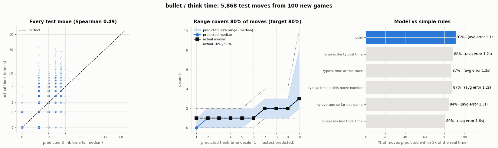

| model / rule | MAE | median error | within 2x | bias (pred − actual) |
|---|---:|---:|---:|---:|
| **model** | 1.08s | 1.0s | 91.3% | -0.36s |
| always the typical time | 1.24s | 1.0s | 88.4% | -0.85s |
| typical time at this clock | 1.22s | 1.0s | 86.9% | -0.44s |
| typical time at this move number | 1.20s | 1.0s | 87.5% | -0.37s |
| my average so far this game | 1.29s | 1.0s | 84.3% | -0.78s |
| repeat my last think time | 1.59s | 1.0s | 80.5% | -0.02s |

Median predicted range width: 2s. A negative bias is expected: the median of a skewed distribution sits below its average.

### blunder

- 5,940 moves, 329 actual (5.5%); model expected 307.
- Accuracy if we call 'blunder' when risk ≥ 50%: 94.5% vs 94.5% for always saying 'no' (why accuracy is the wrong yardstick here).
- Flagging the riskiest 10% of moves: 28% of flags were real (vs 5.5% at random, 5.1x), catching 51% of all blunder events.
- Log-loss skill 0.253 (0.218–0.288) and Brier skill 0.153 (0.112–0.190) vs always guessing the training rate (5.5% actual here). Calibration error (ECE) 0.7 points.
- Per player-game (200 of them): predicted vs real number of blunders correlate 0.72; average miss 0.90 blunders (players made 1.65 on average).
- **1/0 flag** (cutoff 17.9%, best F1): 00 quiet 5,305, 11 caught 143, 10 false alarms 306, 01 missed 186: precision 32%, recall 43%, F1 0.37; accuracy 91.7% vs 94.5% for always 0.

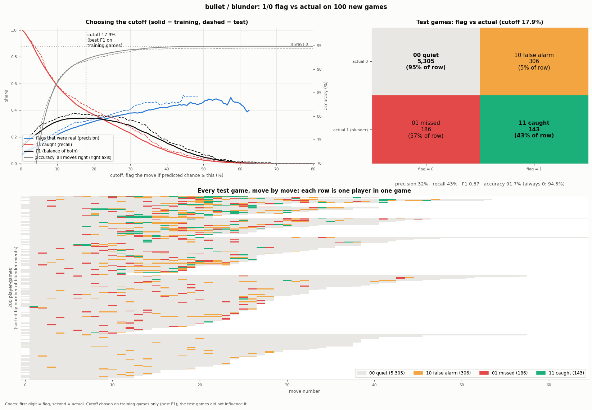

### blunder in next 5

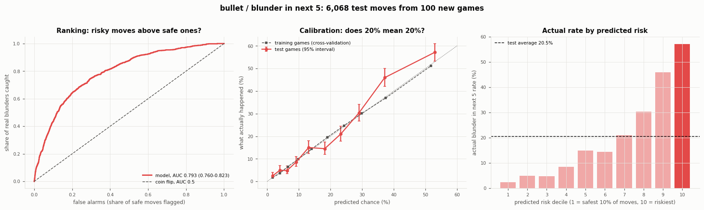

- 6,068 moves, 1242 actual (20.5%); model expected 1182.
- Accuracy if we call 'blunder' when risk ≥ 50%: 81.0% vs 79.5% for always saying 'no' (why accuracy is the wrong yardstick here).
- Flagging the riskiest 10% of moves: 57% of flags were real (vs 20.5% at random, 2.8x), catching 28% of all blunder in next 5 events.
- Log-loss skill 0.181 (0.142–0.222) and Brier skill 0.187 (0.143–0.230) vs always guessing the training rate (20.5% actual here). Calibration error (ECE) 2.6 points.
- **1/0 flag** (cutoff 22.6%, best F1): 00 quiet 3,515, 11 caught 884, 10 false alarms 1311, 01 missed 358: precision 40%, recall 71%, F1 0.51; accuracy 72.5% vs 79.5% for always 0.

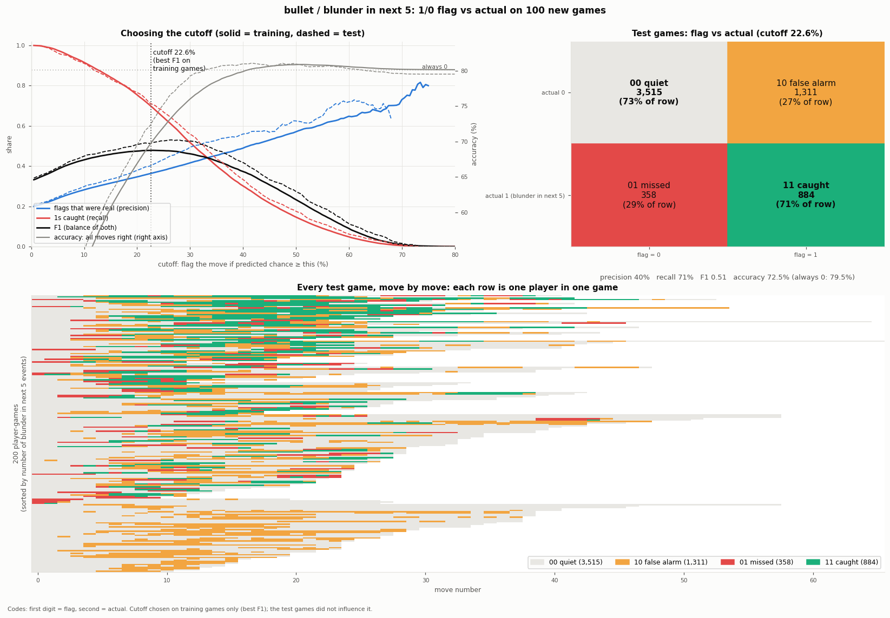

### example game

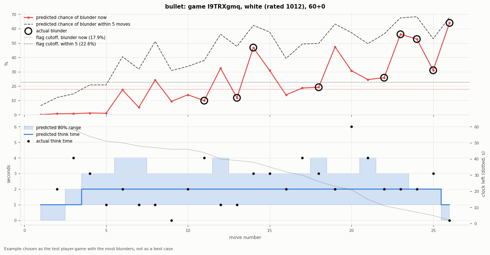

Player-game I9TRXgmq (white): the test game with the most blunders by one player.

## blitz

### think time

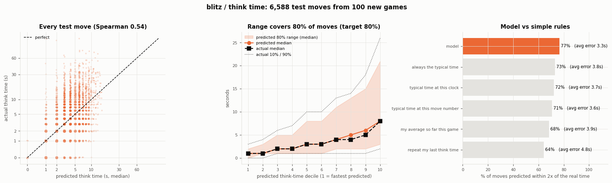

| model / rule | MAE | median error | within 2x | bias (pred − actual) |
|---|---:|---:|---:|---:|
| **model** | 3.32s | 2.0s | 76.6% | -1.51s |
| always the typical time | 3.78s | 2.0s | 73.2% | -2.12s |
| typical time at this clock | 3.67s | 2.0s | 72.1% | -2.17s |
| typical time at this move number | 3.62s | 2.0s | 70.8% | -2.20s |
| my average so far this game | 3.90s | 2.0s | 68.5% | -1.27s |
| repeat my last think time | 4.78s | 2.0s | 64.1% | -0.04s |

Median predicted range width: 7s. A negative bias is expected: the median of a skewed distribution sits below its average.

### blunder

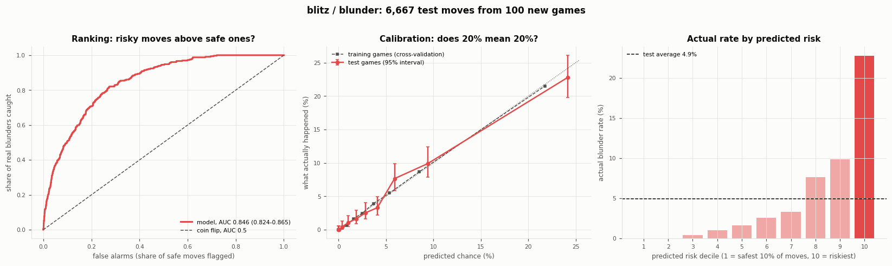

- 6,667 moves, 329 actual (4.9%); model expected 332.
- Accuracy if we call 'blunder' when risk ≥ 50%: 95.0% vs 95.1% for always saying 'no' (why accuracy is the wrong yardstick here).
- Flagging the riskiest 10% of moves: 23% of flags were real (vs 4.9% at random, 4.6x), catching 46% of all blunder events.
- Log-loss skill 0.215 (0.178–0.252) and Brier skill 0.114 (0.074–0.154) vs always guessing the training rate (4.9% actual here). Calibration error (ECE) 0.5 points.
- Per player-game (200 of them): predicted vs real number of blunders correlate 0.71; average miss 0.91 blunders (players made 1.65 on average).
- **1/0 flag** (cutoff 14.6%, best F1): 00 quiet 5,910, 11 caught 136, 10 false alarms 428, 01 missed 193: precision 24%, recall 41%, F1 0.30; accuracy 90.7% vs 95.1% for always 0.

### blunder in next 5

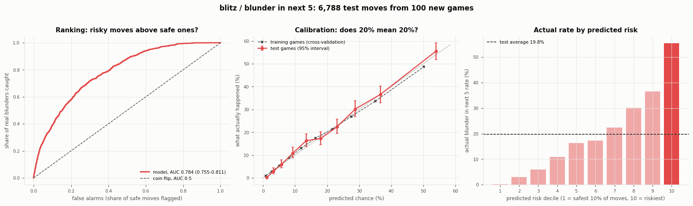

- 6,788 moves, 1345 actual (19.8%); model expected 1313.
- Accuracy if we call 'blunder' when risk ≥ 50%: 81.6% vs 80.2% for always saying 'no' (why accuracy is the wrong yardstick here).
- Flagging the riskiest 10% of moves: 56% of flags were real (vs 19.8% at random, 2.8x), catching 28% of all blunder in next 5 events.
- Log-loss skill 0.179 (0.143–0.217) and Brier skill 0.172 (0.132–0.213) vs always guessing the training rate (19.8% actual here). Calibration error (ECE) 1.0 points.
- **1/0 flag** (cutoff 23.4%, best F1): 00 quiet 4,016, 11 caught 907, 10 false alarms 1427, 01 missed 438: precision 39%, recall 67%, F1 0.49; accuracy 72.5% vs 80.2% for always 0.

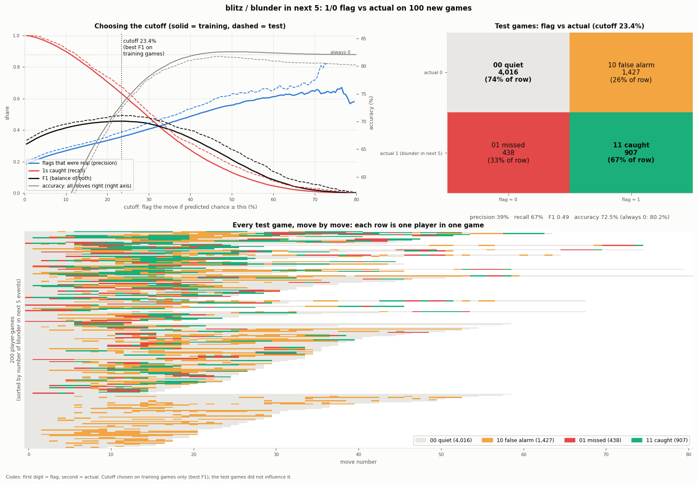

### example game

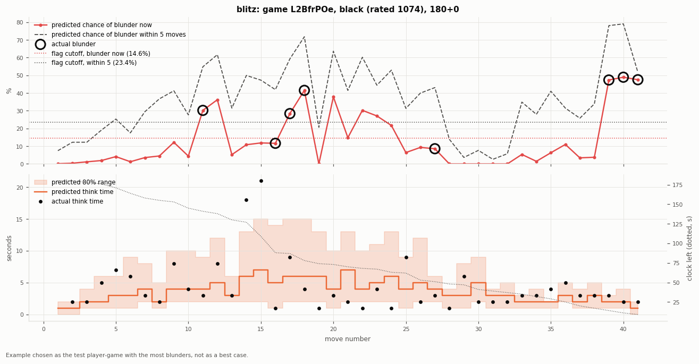

Player-game L2BfrPOe (black): the test game with the most blunders by one player.

## classical

### think time

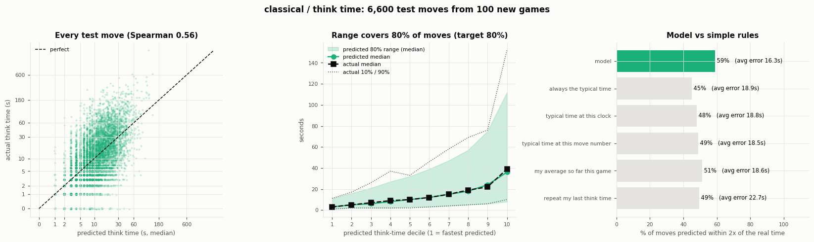

| model / rule | MAE | median error | within 2x | bias (pred − actual) |
|---|---:|---:|---:|---:|
| **model** | 16.33s | 7.0s | 59.0% | -9.67s |
| always the typical time | 18.92s | 7.0s | 45.0% | -13.85s |
| typical time at this clock | 18.75s | 7.0s | 48.1% | -13.83s |
| typical time at this move number | 18.49s | 7.0s | 48.9% | -13.61s |
| my average so far this game | 18.61s | 10.0s | 51.1% | -4.19s |
| repeat my last think time | 22.66s | 9.0s | 49.4% | -0.21s |

Median predicted range width: 33s. A negative bias is expected: the median of a skewed distribution sits below its average.

### blunder

- 6,669 moves, 250 actual (3.7%); model expected 280.
- Accuracy if we call 'blunder' when risk ≥ 50%: 96.2% vs 96.3% for always saying 'no' (why accuracy is the wrong yardstick here).
- Flagging the riskiest 10% of moves: 19% of flags were real (vs 3.7% at random, 5.0x), catching 50% of all blunder events.
- Log-loss skill 0.228 (0.192–0.262) and Brier skill 0.093 (0.060–0.127) vs always guessing the training rate (3.7% actual here). Calibration error (ECE) 0.6 points.
- Per player-game (200 of them): predicted vs real number of blunders correlate 0.72; average miss 0.81 blunders (players made 1.25 on average).
- **1/0 flag** (cutoff 16.2%, best F1): 00 quiet 6,140, 11 caught 89, 10 false alarms 279, 01 missed 161: precision 24%, recall 36%, F1 0.29; accuracy 93.4% vs 96.3% for always 0.

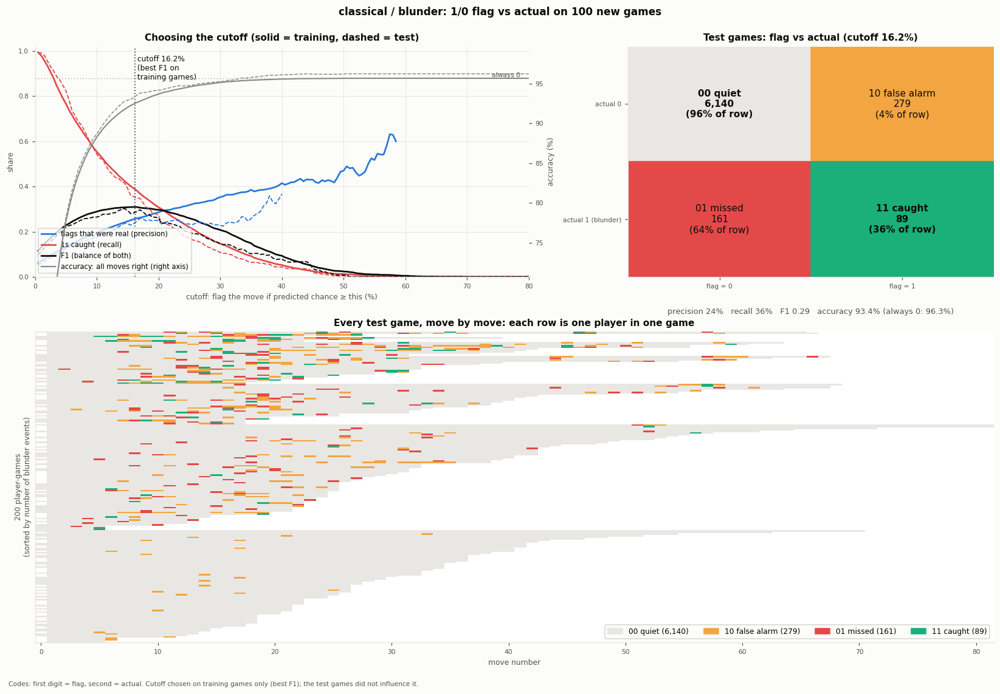

### blunder in next 5

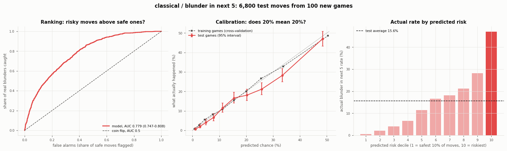

- 6,800 moves, 1061 actual (15.6%); model expected 1165.
- Accuracy if we call 'blunder' when risk ≥ 50%: 84.6% vs 84.4% for always saying 'no' (why accuracy is the wrong yardstick here).
- Flagging the riskiest 10% of moves: 47% of flags were real (vs 15.6% at random, 3.0x), catching 30% of all blunder in next 5 events.
- Log-loss skill 0.160 (0.120–0.197) and Brier skill 0.138 (0.094–0.177) vs always guessing the training rate (15.6% actual here). Calibration error (ECE) 1.8 points.
- **1/0 flag** (cutoff 22.3%, best F1): 00 quiet 4,296, 11 caught 668, 10 false alarms 1443, 01 missed 393: precision 32%, recall 63%, F1 0.42; accuracy 73.0% vs 84.4% for always 0.

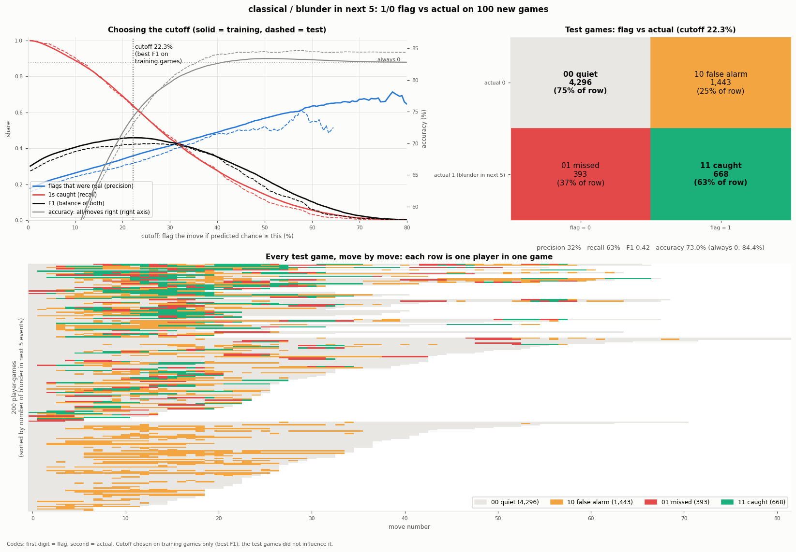

### example game

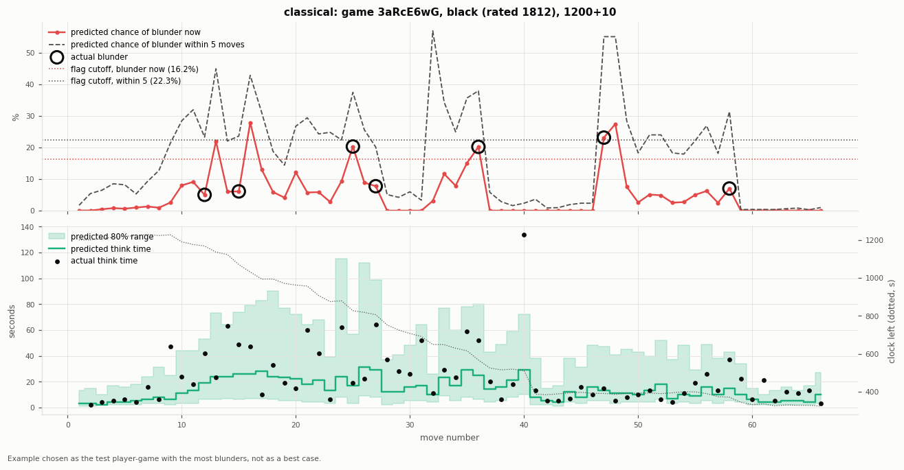

Player-game 3aRcE6wG (black): the test game with the most blunders by one player.

